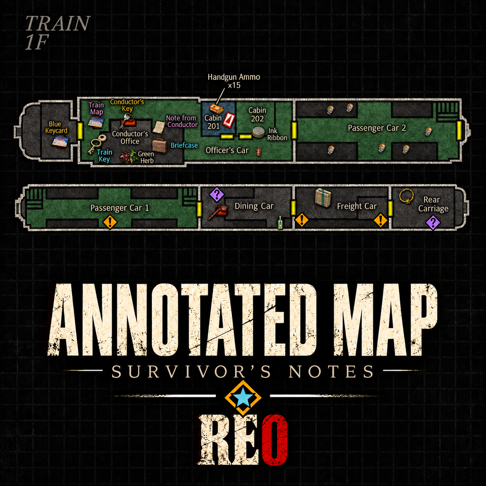
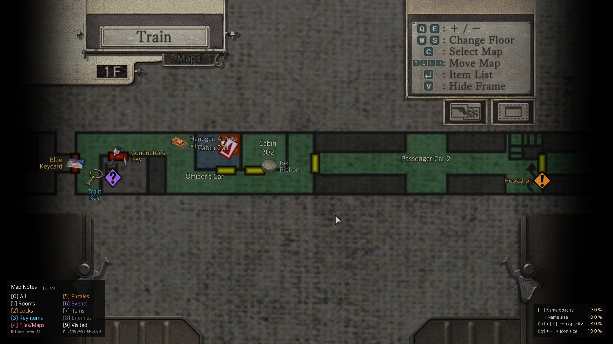
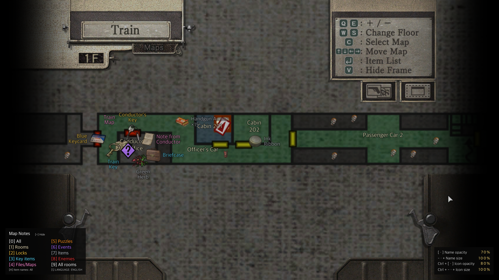
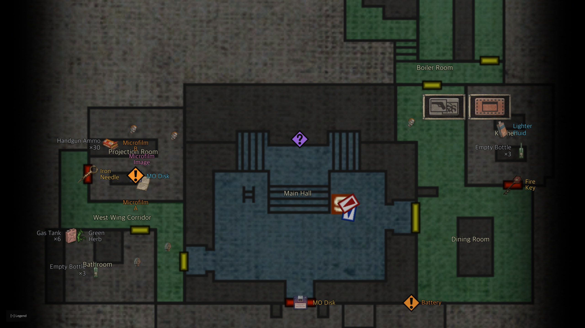
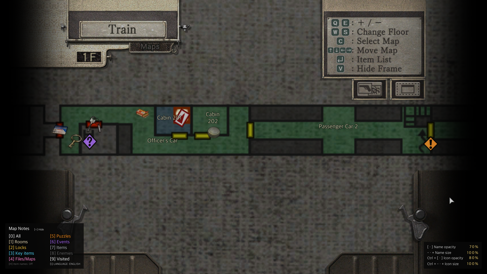

# RE0 상세 지도: 생존자의 메모 — 바이오하자드 제로 HD 리마스터

[English](README.md) | 한국어

<p align="center"></p>

Steam·GOG PC판 Resident Evil 0 / biohazard 0 HD REMASTER의 게임 지도에 방 이름, 잠긴 문, 핵심 아이템, 문서·지도, 퍼즐, 이벤트, 일반 아이템, 적을 표시하는 ASI 모드입니다. 한국어와 영어를 지원합니다.

- 게임의 지도 화면 위에 그리며, 게임의 지도 확대·이동·층 선택을 그대로 따릅니다.
- 주운 아이템, 푼 퍼즐, 연 문, 처치한 적은 지도에서 사라집니다. 이야기 진행에 따라 나타나는 아이템과 Leech Hunter 보상은 얻을 수 있게 되면 표시됩니다.
- 난이도는 게임에서 읽으므로, 플레이 중인 난이도에 맞는 아이템과 적이 표시됩니다.
- 엑스트라 게임 Leech Hunter에서는 플레이 중인 배치의 아이템, 거머리 부적, 적이 표시됩니다.
- 분류마다 아이콘과 색이 있고, 왼쪽 아래 범례에 정리되어 있습니다.

## 스크린샷

| 방문한 방 | 모든 방 |
|---|---|
|  |  |
|  |  |

## 표시 범위와 기본값

처음 설정은 **한국어, 이름 크기 100%, 이름 불투명도 60%, 아이콘 크기 100%, 아이콘 불투명도 80%, 방문한 방만 표시, 이벤트를 뺀 모든 분류 켬, 아이템 이름 끔**입니다. `\`로 영어, `H`로 아이템 이름, `6`으로 이벤트를 켭니다. `9`로 표시 범위를 바꿉니다. **공개된 방**은 지도를 가진 지역의 방까지, **모든 방**은 화면에 있는 층의 모든 방을 표시하며 아직 가 보지 않은 방과 아이템도 보입니다(스포일러).

## 요구 사항

- **Resident Evil 0 / biohazard 0 HD REMASTER, Steam 또는 GOG PC판** (`re0hd.exe`).
- [Ultimate ASI Loader](https://github.com/ThirteenAG/Ultimate-ASI-Loader) v9.7.4(MIT)가 `dinput8.dll`로 포함되어 있습니다.

## 설치

1. 게임을 종료합니다. [Releases](https://github.com/eggu/resident-evil-0-annotated-map/releases/latest)에서 `RE0-Annotated-Map-<버전>.zip`을 내려받아 압축을 풉니다. `Source code`는 설치용 파일이 아닙니다.
2. `re0hd.exe`가 있는 폴더를 엽니다:
   - Steam: 라이브러리에서 **Resident Evil 0**을 우클릭 → **관리** → **로컬 파일 탐색**.
   - GOG: GOG Galaxy에서 게임을 열고 **설치 관리** → **폴더 표시**.
3. ZIP의 내용(`dinput8.dll`, `scripts/`)을 폴더 구조 그대로 그 폴더에 복사합니다.
   - 다른 ASI 모드로 `dinput8.dll`이 이미 있으면 기존 파일을 두고 `scripts/`만 복사하세요.
4. 게임을 실행하고 지도를 엽니다.

업그레이드할 때는 `scripts/RE0.AnnotatedMap.ini`를 건너뛰거나 백업 후 복원하세요.

제거: `scripts/`에서 이름이 `RE0.AnnotatedMap`으로 시작하는 파일을 지웁니다. 다른 ASI 모드가 쓰지 않으면 `dinput8.dll`도 지웁니다. EXE와 세이브 파일은 수정하지 않습니다. 지원하지 않는 실행 파일에서는 아무것도 패치하지 않고 `scripts/RE0.AnnotatedMap.log`만 남깁니다.

## 조작

키는 지도 화면에서, 게임 창에 포커스가 있을 때만 작동합니다. 왼쪽 아래 범례에 켜진 분류가, 오른쪽 아래 패널에 현재 크기와 불투명도가 표시됩니다.

| 키 | 기능 |
|---|---|
| 0 | 전체 표시 켜기/끄기(범례는 유지) |
| 1 | 방 이름 |
| 2 | 잠긴 문 |
| 3 | 핵심 아이템 |
| 4 | 문서·지도 |
| 5 | 퍼즐 |
| 6 | 이벤트(스포일러: 컷신과 적 등장이 시작되는 곳. 일어난 뒤에는 숨겨짐. 기본 꺼짐) |
| 7 | 일반 아이템 |
| 8 | 적 |
| 9 | 표시 범위: 방문한 방 → 공개된 방 → 모든 방 |
| `\`(한국어 키보드의 ₩) | 한국어 / English |
| H | 아이템 이름: 모두 → 일반 아이템 제외 → 끔(기본 끔) |
| ~ (1 왼쪽) | 범례를 한 줄로 접거나 다시 펼침. 크기 패널도 함께 접힘 |
| - · + (숫자패드 포함) | 이름 크기 10% 단위(50–150%) |
| [ · ] | 이름 불투명도 10% 단위(10–100%) |
| Ctrl + - · + | 아이콘 크기 10% 단위(50–200%) |
| Ctrl + [ · ] | 아이콘 불투명도 10% 단위(10–100%) |

지도 확대, 이동, 층 선택은 게임의 원래 조작을 사용합니다.

## 설정 (`scripts/RE0.AnnotatedMap.ini`)

릴리스 ZIP에 기본 INI가 들어 있습니다. 게임에서 바꾼 설정은 자동으로 저장됩니다. 파일을 직접 고칠 때는 먼저 게임을 종료하세요. 업그레이드할 때 기존 INI를 유지하면 설정이 그대로 남습니다.

| 설정 | 기본값 | 설명 |
|---|---|---|
| `Enabled` | `1` | 전체 표시(`0` 키) |
| `Names` | `1` | 방 이름(`1` 키) |
| `Contents` | `63` | 분류를 비트의 합으로 지정: 1 잠긴 문, 2 핵심 아이템, 4 문서·지도, 8 퍼즐, 16 일반 아이템, 32 적, 64 이벤트. `127`은 모두 켬 |
| `English` | `0` | `0` 한국어, `1` 영어 |
| `Visibility` | `0` | `0` 방문한 방, `1` 공개된 방, `2` 모든 방 |
| `ItemNames` | `0` | `0` 끔, `1` 모두, `2` 일반 아이템 제외 |
| `NameSize` | `100` | 이름 크기(50–150) |
| `NameOpacity` | `60` | 이름 불투명도(10–100) |
| `IconSize` | `100` | 아이콘 크기(50–200) |
| `IconOpacity` | `80` | 아이콘 불투명도(10–100) |
| `Legend` | `1` | `1` 범례 표시, `0` 접기 |
| `Difficulty` | `1` | `0` 쉬움, `1` 보통, `2` 어려움. 게임이 난이도를 알려 주지 않는 모드에서만 사용 |
| `Version` | `52` | 설정 형식. 자동으로 기록되므로 고치지 마세요 |

`[Colors]` 섹션에서 분류별 색을 `#RRGGBB`로 지정합니다: `Lock`, `KeyItem`, `File`, `Puzzle`, `Event`, `Item`, `Enemy`. 줄을 지우면 기본 색으로 돌아갑니다. 게임에서 설정을 저장해도 색과 주석은 그대로 남습니다.

## 알려진 제한

- 표식은 아이템·퍼즐·적이 있는 방을 알려 줄 뿐, 방 안의 정확한 위치는 아닙니다.
- 방이 붐비면 일반 아이템과 적의 이름, 또는 핵심 아이템과 겹치는 표식이 숨겨질 수 있습니다. 게임의 지도 확대로 더 볼 수 있습니다.
- 바닥에 내려놓은 아이템은 이 모드가 아니라 게임 지도가 직접 표시합니다.
- 여왕 거머리 2차 형태는 그 방을 나간 뒤에도 지도에 남습니다.
- **모든 방**에서는 다음에 지도를 열거나 층을 바꿀 때부터 게임이 가 보지 않은 방을 회색으로 그립니다. 가 보지 않은 층과 지역은 닫혀 있습니다.
- 한국어 방 이름은 이 모드의 번역입니다.

## 문의

[Issues](https://github.com/eggu/resident-evil-0-annotated-map/issues)에 캐릭터, 지역과 방, 언어·표시 범위 설정, 스크린샷을 함께 남겨 주세요. 로드 문제라면 개인 경로를 지운 `scripts/RE0.AnnotatedMap.log`도 첨부해 주세요.

## 위키

[개발자 위키](docs/wiki/README.md)([English](docs/wiki/README.en.md))에 비슷한 지도 모드를 만드는 분을 위한 표시 규칙, 배치 규칙, 아이콘, 데이터 조건, 렌더링 설명이 있습니다.

## 빌드

Python 3.10 이상, MinGW-w64(`i686-w64-mingw32-gcc`), 테스트에는 Clang이 필요합니다.

```sh
python3 -m venv .venv
.venv/bin/python -m pip install -r requirements-dev.txt -r requirements-research.txt
.venv/bin/python build.py          # dist/RE0-Annotated-Map-<버전>.zip
.venv/bin/python build.py --test   # + 이식 가능한 테스트와 합성 테스트
```

`src/runtime/re0_map.c`가 런타임 소스이고, `src/core/`에는 테스트와 함께 쓰는 지도·배치·그리기 로직이 있습니다. 라벨 래스터는 미리 만들어 두었으며, `tools/build_labels.py`가 포함된 Pretendard 글꼴로 다시 만듭니다. [개발 노트](docs/DEVELOPMENT.md)를 참고하세요.

## 다른 지도 모드

- [RE1 Annotated Map - Survivor's Notes](https://github.com/eggu/resident-evil-annotated-map) — Resident Evil (1996)
- [RE1 HD Annotated Map - Survivor's Notes](https://github.com/eggu/resident-evil-hd-annotated-map) — Resident Evil HD REMASTER
- [RE2 Annotated Map - Survivor's Notes](https://github.com/eggu/resident-evil-2-annotated-map) — Resident Evil 2 (1998)
- [RE3 Annotated Map - Survivor's Notes](https://github.com/eggu/resident-evil-3-annotated-map) — Resident Evil 3: Nemesis (1999)

## 제작과 라이선스

제작: **커트씨**. 소스 코드는 [MIT 라이선스](LICENSE)입니다. Capcom과 관련 없는 비공식 팬 모드입니다. 방 이름과 내용은 [Evil Resource](https://www.evilresource.com/)와 대조했습니다. 참고 자료, 아이콘·글꼴 출처는 [NOTICE](NOTICE.md)에 있습니다.
