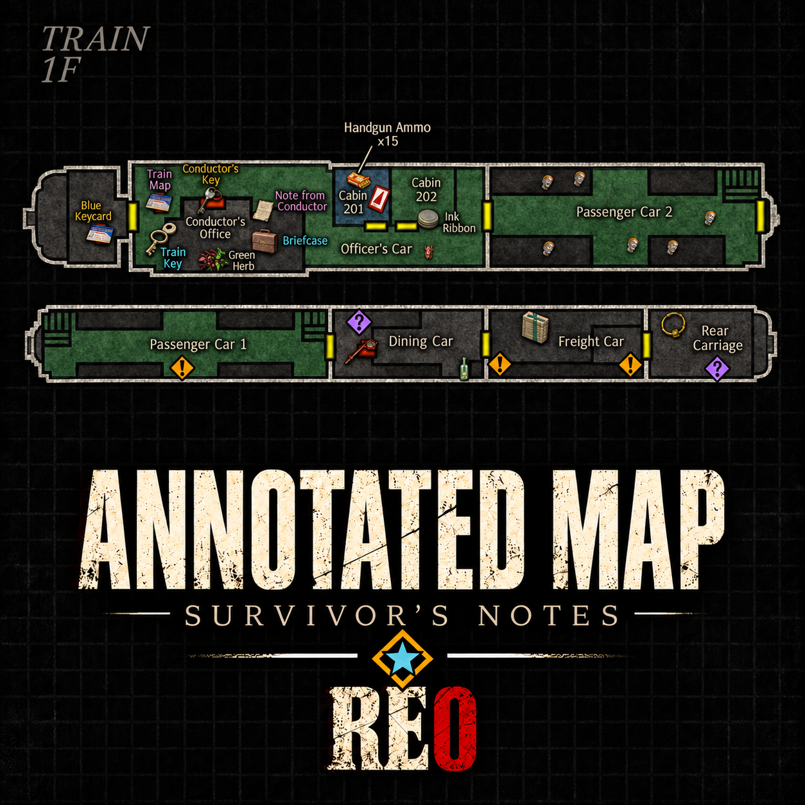
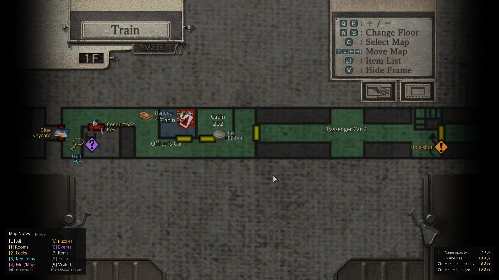
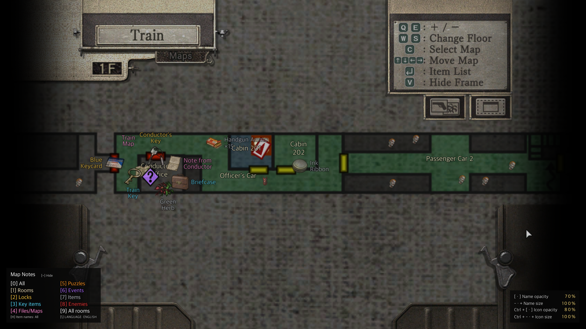
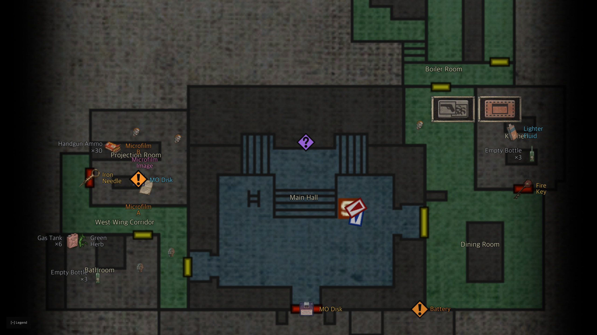
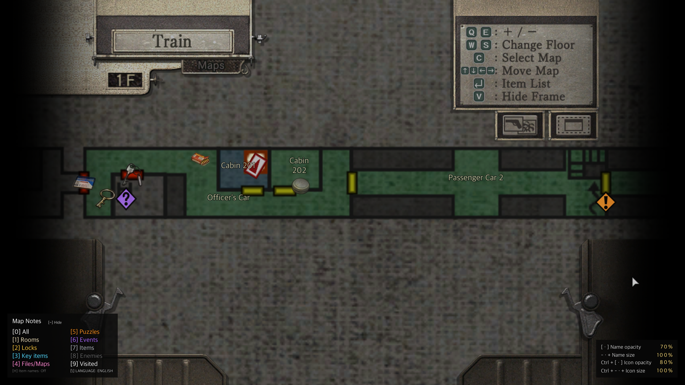

# RE0 Annotated Map - Survivor's Notes — Resident Evil 0 HD REMASTER

English | [한국어](README.ko.md)

<p align="center"></p>

An ASI mod for the Steam and GOG PC versions of Resident Evil 0 / biohazard 0 HD REMASTER that adds room names, locked doors, key items, files and maps, puzzles, events, common items and enemies to the game's own map. Korean and English are supported.

- Annotations are drawn on the game's map screen and follow its zoom, scrolling and floor selection.
- Taken items, solved puzzles, opened doors and defeated enemies disappear from the map. Items that appear later in the story and Leech Hunter rewards are shown when they become available.
- The difficulty is read from the game, so the items and enemies shown match the difficulty you are playing.
- In the Leech Hunter extra game, the items, Leech Charms and enemies of the layout you are playing are shown.
- Each category has its own icon and colour, listed in a legend at the lower left.

## Screenshots

| Visited rooms | All rooms |
|---|---|
|  |  |
|  |  |

## Visibility and defaults

A new configuration starts in **Korean, name size 100%, name opacity 60%, icon size 100%, icon opacity 80%, visited rooms only, all categories on except events, item names off**. Press `\` for English, `H` for item names and `6` for events. Press `9` to change the scope: **Revealed** adds the rooms of an area whose map you hold, **All rooms** shows every room on the floor on screen, including rooms and items you have not reached (spoilers).

## Requirements

- **Resident Evil 0 / biohazard 0 HD REMASTER, Steam or GOG PC version** (`re0hd.exe`).
- [Ultimate ASI Loader](https://github.com/ThirteenAG/Ultimate-ASI-Loader) v9.7.4 (MIT) is included as `dinput8.dll`.

## Installation

1. Close the game. Download `RE0-Annotated-Map-<version>.zip` from [Releases](https://github.com/eggu/resident-evil-0-annotated-map/releases/latest) and extract it. `Source code` is not the install package.
2. Open the folder containing `re0hd.exe`:
   - Steam: in your library, right-click **Resident Evil 0** → **Manage** → **Browse local files**.
   - GOG: in GOG Galaxy, open the game → **Manage installation** → **Show folder**.
3. Copy the ZIP contents (`dinput8.dll`, `scripts/`) into that folder, preserving the folder structure.
   - If you already have a `dinput8.dll` from another ASI mod, keep yours and copy `scripts/` only.
4. Start the game and open the map.

When upgrading, skip `scripts/RE0.AnnotatedMap.ini` or back it up and restore it.

Uninstall: delete the files in `scripts/` whose names start with `RE0.AnnotatedMap`. Also delete `dinput8.dll` if no other ASI mod uses it. The EXE and save files are not modified. On an unsupported executable the mod patches nothing and only writes `scripts/RE0.AnnotatedMap.log`.

## Controls

Keys work on the map screen only, while the game window has focus. The legend at the lower left shows which categories are on; the panel at the lower right shows the current sizes and opacities.

| Key | Action |
|---|---|
| 0 | All annotations on/off (the legend stays) |
| 1 | Room names |
| 2 | Locked doors |
| 3 | Key items |
| 4 | Files and maps |
| 5 | Puzzles |
| 6 | Events (spoilers: where cutscenes and enemy appearances start; hidden once they have happened; off by default) |
| 7 | Common items |
| 8 | Enemies |
| 9 | Scope: visited rooms → revealed rooms → all rooms |
| `\` (₩ on Korean keyboards) | Korean / English |
| H | Item names: all → all except common items → off (off by default) |
| ~ (left of 1) | Fold the legend to one line, or show it again; the size panel folds with it |
| - · + (numpad too) | Name size in 10% steps (50–150%) |
| [ · ] | Name opacity in 10% steps (10–100%) |
| Ctrl + - · + | Icon size in 10% steps (50–200%) |
| Ctrl + [ · ] | Icon opacity in 10% steps (10–100%) |

Map zoom, scrolling and floor selection use the game's own controls.

## Settings (`scripts/RE0.AnnotatedMap.ini`)

The release ZIP includes a default INI. Settings changed in game are saved automatically. To edit the file by hand, close the game first. Keep your existing INI when upgrading to preserve your settings.

| Setting | Default | Description |
|---|---|---|
| `Enabled` | `1` | All annotations (`0` key) |
| `Names` | `1` | Room names (`1` key) |
| `Contents` | `63` | Categories as a sum of bits: 1 locked doors, 2 key items, 4 files and maps, 8 puzzles, 16 common items, 32 enemies, 64 events. `127` turns everything on |
| `English` | `0` | `0` Korean, `1` English |
| `Visibility` | `0` | `0` visited rooms, `1` revealed rooms, `2` all rooms |
| `ItemNames` | `0` | `0` off, `1` all, `2` all except common items |
| `NameSize` | `100` | Name size (50–150) |
| `NameOpacity` | `60` | Name opacity (10–100) |
| `IconSize` | `100` | Icon size (50–200) |
| `IconOpacity` | `80` | Icon opacity (10–100) |
| `Legend` | `1` | `1` legend shown, `0` folded |
| `Difficulty` | `1` | `0` Easy, `1` Normal, `2` Hard. Used only in modes where the game does not report a difficulty |
| `Version` | `52` | Settings format, written automatically; do not edit |

The `[Colors]` section sets each category's colour as `#RRGGBB`: `Lock`, `KeyItem`, `File`, `Puzzle`, `Event`, `Item`, `Enemy`. Delete a line to get the default colour back. Saving settings in game keeps your colours and comments.

## Known limitations

- Marks show which room an item, puzzle or enemy is in, not its exact spot inside the room.
- When a room is crowded, names of common items and enemies, or marks overlapping a key item, may be hidden. Zoom in with the game's map controls to see more.
- Items you drop are shown by the game's own map, not by this mod.
- The Queen Leech's second form stays on the map after you leave its room.
- With **All rooms**, the game draws unreached rooms in grey from the next time you open the map or change floor. Floors and areas you have not reached stay closed.
- Korean room names are this mod's own translations.

## Support

Report issues in [Issues](https://github.com/eggu/resident-evil-0-annotated-map/issues) with the character, area and room, language and scope settings, and a screenshot. For loading problems, include `scripts/RE0.AnnotatedMap.log`, removing personal paths before sharing.

## Wiki

The [developer wiki](docs/wiki/README.en.md) ([한국어](docs/wiki/README.md)) describes the display rules, placement rules, icon art, data conditions and rendering for anyone building a similar map mod.

## Build

Requires Python 3.10+, MinGW-w64 (`i686-w64-mingw32-gcc`) and, for tests, Clang.

```sh
python3 -m venv .venv
.venv/bin/python -m pip install -r requirements-dev.txt -r requirements-research.txt
.venv/bin/python build.py          # dist/RE0-Annotated-Map-<version>.zip
.venv/bin/python build.py --test   # + portable and synthetic tests
```

`src/runtime/re0_map.c` is the runtime source; `src/core/` holds the map, placement and drawing logic shared with the tests. Label rasters are prebuilt; `tools/build_labels.py` regenerates them with the bundled Pretendard font. See the [development notes](docs/DEVELOPMENT.md).

## Other map mods

- [RE1 Annotated Map - Survivor's Notes](https://github.com/eggu/resident-evil-annotated-map) — Resident Evil (1996)
- [RE1 HD Annotated Map - Survivor's Notes](https://github.com/eggu/resident-evil-hd-annotated-map) — Resident Evil HD REMASTER
- [RE2 Annotated Map - Survivor's Notes](https://github.com/eggu/resident-evil-2-annotated-map) — Resident Evil 2 (1998)
- [RE3 Annotated Map - Survivor's Notes](https://github.com/eggu/resident-evil-3-annotated-map) — Resident Evil 3: Nemesis (1999)

## Credits and license

Created by **커트씨**. The source code is under the [MIT License](LICENSE). This is an unofficial fan mod, unaffiliated with Capcom. Room names and contents were cross-checked against [Evil Resource](https://www.evilresource.com/). References, icon and font provenance are listed in [NOTICE](NOTICE.md).
